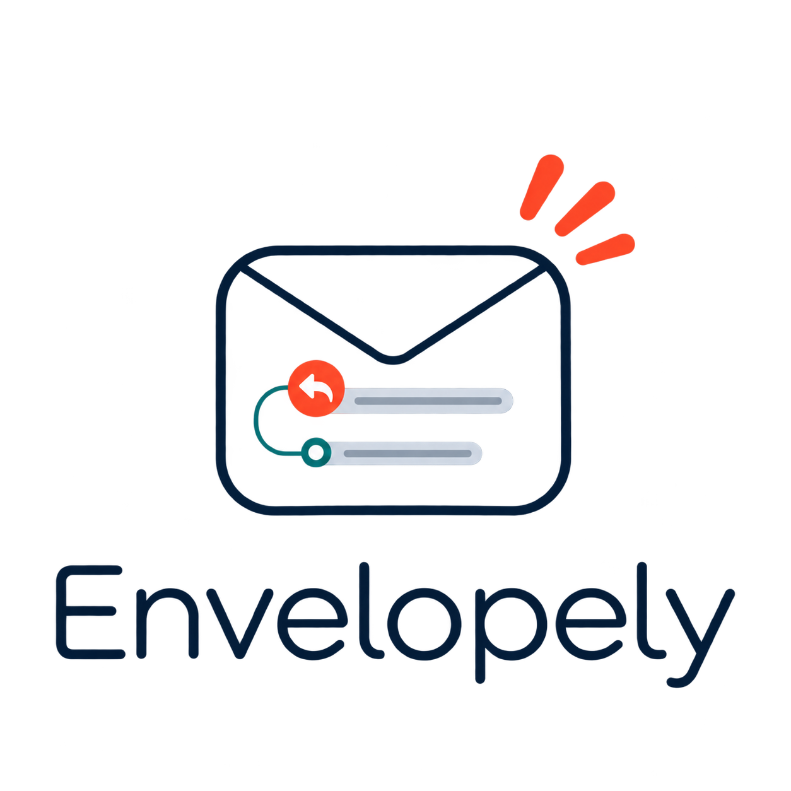

<p align="center">
  
</p>

# Envelopely

Envelopely is a small, local command-line tool for preparing and sending thoughtful, individually reviewed email correspondence. It combines a CSV address book with plain-text templates, validates every message, creates `.eml` previews, and sends through your own SMTP account only when you explicitly approve the run.

It is intended for legitimate, low-volume communication with people or organizations you have a reasonable basis to contact—for example, professional introductions, partnership enquiries, community updates, or follow-ups.

Envelopely is not a lead scraper, mailing-list builder, tracking platform, deliverability bypass, or high-volume marketing system. It does not discover addresses, hide the sender, rotate accounts, track opens, or send in parallel.

## Safety by default

- A normal run is a dry run: `--send` is required to transmit anything.
- `--check` performs preflight validation without writing or sending files.
- `.eml` previews let you inspect the exact message and attachment first.
- Sending requires typing the exact number of approved messages unless `--yes` is deliberately supplied.
- The default run limit is 10 messages.
- Generic addresses such as `info@` and `contact@` are skipped unless explicitly enabled.
- `sent_log.csv` prevents repeat contact by email address or normalized organization name.
- Each row has a status, so a person remains ineligible until intentionally marked for contact.
- SMTP credentials stay in a local `.env` file excluded from Git.

## Responsible use

Only contact recipients when the message is relevant and you have a legitimate reason—and, where required, consent or another lawful basis—to write to them. Identify yourself accurately, use truthful subjects, provide a simple way to decline further messages, record opt-outs, and comply with the privacy and electronic-communications rules that apply to you and the recipient.

Do not use purchased, harvested, or indiscriminately scraped address lists. Envelopely cannot determine whether a contact is lawful or appropriate; that responsibility remains with the sender.

## Requirements

- Go 1.22 or newer
- Access to an SMTP account only if you intend to send
- Git is optional but convenient for cloning the repository

Check your Go installation with:

```sh
go version
```

## Installation

### Linux

Install a current Go release using your distribution's package manager or the official Go installation instructions. Then clone and build Envelopely:

```sh
git clone https://github.com/espositopasquale/envelopely.git
cd envelopely
go build -o envelopely .
./envelopely --help
```

To make it available from any terminal without administrator access:

```sh
mkdir -p "$HOME/.local/bin"
install -m 755 envelopely "$HOME/.local/bin/envelopely"
```

Ensure `$HOME/.local/bin` is included in your `PATH`.

### macOS

Install Go from the official installer or with Homebrew:

```sh
brew install go
```

Then build Envelopely:

```sh
git clone https://github.com/espositopasquale/envelopely.git
cd envelopely
go build -o envelopely .
./envelopely --help
```

Optional user-local installation:

```sh
mkdir -p "$HOME/.local/bin"
cp envelopely "$HOME/.local/bin/envelopely"
chmod 755 "$HOME/.local/bin/envelopely"
```

Add `$HOME/.local/bin` to your shell `PATH` if it is not already present.

### Windows

Install Go, open PowerShell in the project folder, and run:

```powershell
git clone https://github.com/espositopasquale/envelopely.git
Set-Location envelopely
go build -o envelopely.exe .
.\envelopely.exe --help
```

You may keep `envelopely.exe` in the project folder or move it to a directory listed in your user `PATH`.

## Local web interface

If you prefer a guided interface, start the bundled local web UI from the project root:

Windows PowerShell:

```powershell
.\run-webui.ps1
```

Linux and macOS:

```sh
chmod +x run-webui.sh
./run-webui.sh
```

Then open [http://127.0.0.1:8080](http://127.0.0.1:8080). The server listens on the local machine only, builds the Envelopely CLI, and uses it for preflight, previews, and approved sends.

The interface lets you:

- import a contact CSV, attachment, and plain-text template;
- edit and save templates locally;
- choose language, audience, eligible status, limit, and delay;
- run preflight and create `.eml` previews;
- enable generic inboxes only when appropriate;
- send only after confirming the exact count from a fresh server-side preflight.
- configure the local sender identity and SMTP account without displaying the saved password.

The account panel writes settings to the selected local environment file. Existing passwords are preserved when the password field is left empty. The file still contains plain-text secrets, so use this feature only on a trusted, access-controlled machine and never expose the local Web UI to a public network.

Uploaded files remain in the local project folders. Do not expose the web server to a public network or commit uploaded contacts and attachments.

To use a different local listen address, set `ENVELOPELY_WEB_ADDR`, for example `127.0.0.1:9090`.

### Logo variants

The `assets` folder includes three logo treatments:

- `envelopely-logo.png`: original transparent logo for light surfaces;
- `envelopely-logo-dark-wide.png`: horizontal lockup for dark headers and banners;
- `envelopely-logo-dark-icon.png`: compact app mark for dark toolbars and icons.
- `envelopely-logo-dark-transparent.png`: transparent light-mark variant used on the Web UI's blue title bar.

## Configuration

Copy the example environment file:

Linux and macOS:

```sh
cp .env.example .env
```

Windows PowerShell:

```powershell
Copy-Item .env.example .env
```

Edit `.env` with your sender identity and, only when needed, SMTP settings. Never commit this file—it may contain an SMTP password.

Both the CLI and Web UI use `.env` first. If it does not exist, they fall back to `.env.local`.

There is no file named `MAIL_ENV_FILE`. For advanced setups only, `MAIL_ENV_FILE` is an optional operating-system environment variable whose value is the path to a different configuration file, for example:

```sh
MAIL_ENV_FILE=/secure/path/envelopely.env ./envelopely --check
```

> **Credential safety:** A completed `.env.local`, `.env`, or custom environment file stores secrets as plain text. It is read at runtime and is not compiled into the Envelopely executable, so building the program does not protect the file. Create and use it only in a trusted, access-controlled local environment. Never commit it to Git, upload it to GitHub or cloud storage, attach it to an email, paste it into an issue or chat, include it in screenshots or logs, or distribute it with a compiled binary. Prefer a revocable application-specific password or narrowly scoped SMTP token instead of your primary account password. If the file or any output containing its values is exposed, revoke or rotate the affected credentials immediately.

```dotenv
MAIL_SMTP_HOST=smtp.example.com
MAIL_SMTP_PORT=587
MAIL_SMTP_USER=you@example.com
MAIL_SMTP_PASS=replace-me
MAIL_FROM=you@example.com
MAIL_FROM_NAME=Your Name
MAIL_REPLY_TO=you@example.com
```

Your mail provider may require an application-specific password. Follow the provider's security documentation rather than putting your normal account password in `.env`.

## Contact file

The CSV must include:

```text
Email,Company,Greeting,Subject,PersonalizedText,Status,Batch
```

Optional columns:

- `Language`: `en` or `it`
- `Audience`: `technical` or `nontechnical`

Only rows whose `Status` matches `--eligible-status` are considered. The default eligible status is `Not contacted`. See [examples/contacts.csv](examples/contacts.csv) for a fictional example.

Keep personal data to the minimum necessary. Do not commit a real contact CSV to a public repository.

## Recommended workflow

### 1. Prepare a small, relevant list

Add only recipients for whom the message is genuinely relevant. Write a specific `PersonalizedText` value for each row; avoid generic praise or fabricated familiarity.

### 2. Run preflight

Envelopely currently requires at least one attachment. Use the actual document you intend to include:

```sh
./envelopely \
  --contacts examples/contacts.csv \
  --template templates/default.txt \
  --attachment path/to/document.pdf \
  --check
```

On Windows, replace `./envelopely` with `.\envelopely.exe` and use Windows paths.

### 3. Generate previews

```sh
./envelopely \
  --contacts contacts.csv \
  --template templates/default.txt \
  --attachment path/to/document.pdf \
  --preview-dir previews \
  --limit 5
```

Open every generated `.eml` file. Verify the recipient, greeting, subject, personalization, sender identity, links, and attachment.

### 4. Send a small approved run

```sh
./envelopely \
  --contacts contacts.csv \
  --template templates/default.txt \
  --attachment path/to/document.pdf \
  --log sent_log.csv \
  --send \
  --limit 5 \
  --delay 30s
```

Envelopely shows a final preflight and asks you to type the exact send count. Keep `sent_log.csv`; it is the durable duplicate-protection record.

### 5. Record replies and opt-outs

Update your source data when someone replies, declines, or asks not to be contacted. Do not mark that row as eligible again. Envelopely does not automate follow-up sequences or override opt-outs.

## Common options

| Option | Purpose |
| --- | --- |
| `--check` | Validate only; never send or write previews |
| `--preview-dir previews` | Create inspectable `.eml` files |
| `--send` | Explicitly enable SMTP delivery |
| `--limit 5` | Cap the number processed in this run |
| `--delay 30s` | Pause between successful sends |
| `--log sent_log.csv` | Use persistent duplicate protection |
| `--eligible-status "Not contacted"` | Select the only eligible row status |
| `--allow-generic` | Explicitly include generic company inboxes |
| `--template-it FILE` | Use a dedicated Italian template |
| `--template-en FILE` | Use a dedicated English template |
| `--interactive` | Start the guided terminal setup |

Run `./envelopely --help` for the complete option list.

## Templates

Templates use Go's `text/template` syntax. Available values include:

```text
{{.Greeting}} {{.Company}} {{.Email}} {{.Subject}}
{{.PersonalizedText}} {{.Batch}} {{.Language}} {{.Audience}}
{{.SenderName}} {{.SenderTitle}} {{.SenderEmail}} {{.SenderWebsite}}
```

Use `--template-it` and `--template-en` for separate language files. A shared template can branch with:

```gotemplate
{{if eq .Language "it"}}
Testo italiano
{{else}}
English text
{{end}}
```

The bundled template is intentionally neutral. Replace it with language appropriate to your real relationship and purpose; do not imply familiarity, credentials, or needs that you cannot substantiate.

## Before publishing

- Confirm `.env`, real contacts, attachments, previews, and `sent_log.csv` are not staged.
- Keep the sample data fictional.

## License

Copyright (C) 2026 Pasquale Esposito.

Envelopely is free software licensed under the [GNU General Public License, version 3](LICENSE). You may use, study, modify, and redistribute it under the GPLv3 terms. Distributions and modified versions must preserve the applicable notices and make the corresponding source code available as required by the licence.

Envelopely is provided **without any warranty**, to the extent permitted by applicable law. See the [`LICENSE`](LICENSE) file for the complete terms, including the warranty disclaimer and limitation of liability.
